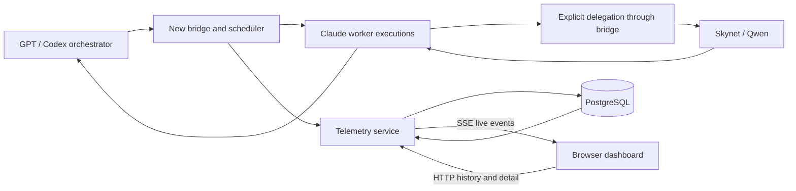
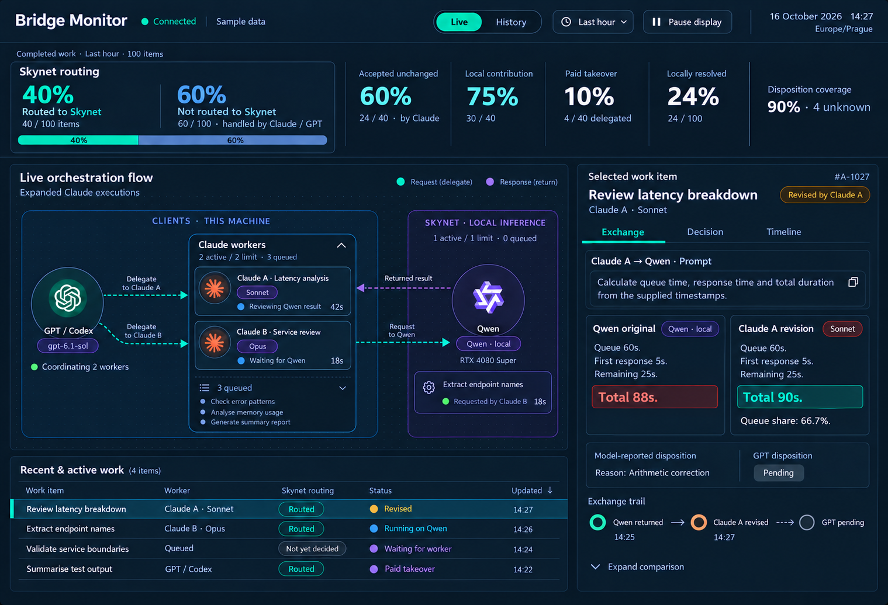

# Bridge Monitor — Phase 1 Specification

**Status:** Draft for human review  
**Date:** 16 October 2026  
**Project:** `C:\AI\bridge-monitor`  
**Existing reference:** `C:\AI\gpt-claude-mcp-bridge-v2`

This specification consolidates the agreed direction for a new bridge and a live dashboard. It defines proposed behavior for review; it does not authorize implementation, installation, runtime changes, or changes to the existing bridge. Numerical starting values below are configurable initial settings, not measured optima.

## 1. Purpose and boundaries

Show how work and information flow from GPT/Codex, through multiple Claude workers, to Qwen on Skynet, the trusted LAN machine with an RTX 4080 Super. Retain the actual exchanges and their context so later analysis can identify which tasks benefit from local delegation and which require paid-model work.

Phase 1 must answer:

- What is running, waiting, returning, failed, or uncertain right now?
- Which worker and requested/reported model handled each execution?
- How much eligible work was routed to Skynet, and how much was explicitly kept with paid models?
- Was each local response accepted, revised, replaced, unused, or left without a disposition?
- How much local work survived into the final observable answer?
- What prompts, responses, timings, usage, configuration, and evidence explain those outcomes?

The main flow is **GPT/Codex → Claude workers → Skynet/Qwen**, with results flowing back. GPT controls Claude fan-out. Claude may explicitly delegate bounded work to Qwen. Recursive Claude-to-Claude spawning and Qwen spawning further agents are outside phase 1.

Phase 1 captures data and provides descriptive operational statistics, with explicit, reviewed configuration gates for guidance eligibility and delegation readiness, and automatic paid fallback on delegation timeouts. It does not learn routing gates from outcomes, automatically optimize policy, or generate quality scores without an explicitly supplied evaluation. Later phases may analyze failures and propose gate changes; every addition, update, or removal requires human review before activation.

## 2. Source isolation and deliverables

All new source must live in subdirectories of `C:\AI`. The proposed project is `C:\AI\bridge-monitor`, separate from both existing bridge directories. This specification and its mockup are the only deliverables created now.

| Proposed directory | Future responsibility |
|---|---|
| `bridge/` | Instrumented adapters, dispatch, scheduling, worker lifecycle, delegation contract |
| `service/` | Event ingestion, durable storage, query API, live event delivery |
| `dashboard/` | Client-rendered Next.js dashboard |
| `database/` | Schema and migration definitions |
| `config/` | Policy file and documented configuration contract |
| `tests/` | Contract, scheduling, recovery, and end-to-end validation |
| `docs/specifications/` | Review specifications and approved visual references |

These source directories are a proposed layout, not scaffolding created by this document. Existing source, configuration, documentation, Git state, and bridge registrations remain untouched. A future approved implementation can reuse code through a separately reviewed copy into the new project, preserving provenance. Cutover requires its own authorization; the new service must not silently replace the existing bridge.

### Existing implementation observations

Read-only source inspection found terminal-call telemetry in `bridge/telemetry.py` and `bridge/service.py`, and single-active-job enforcement in `tools/claude-bridge/implementer_bridge.py`. That implementer path restricts other-agent/MCP invocation and collects its CLI response at completion. Consequently, the proposed concurrent workers, explicit Qwen delegation, and intermediate events require new behavior; they are not claimed as capabilities already available through that path.

The existing LOCAL00 worker contract already supplies useful task packets, validation reports, model/result digests, audit provenance, bounded execution, and conservative handling of uncertain execution. These are reference material. Its approved design and operating limits are not superseded by this draft. A broader analytics taxonomy does not grant broader execution eligibility.

These are source observations, not a live-system verification. The exact deployed model, endpoint, and runtime capabilities must be discovered and validated when the new system is configured.

## 3. Architecture

The dashboard is a **Next.js client-rendered application with no SSR**. A static shell loads data in the browser. PostgreSQL is the initial system of record; Neo4j and a separate message broker are unnecessary for the phase 1 relationships and queries.

This diagram is logical: adapter processes may contribute events through the bridge. GPT and Claude clients running on this machine must not be depicted as inference running on its GPU. Model provider, execution host, and worker host are separate attributes.

Use **SSE for service-to-browser live updates**, with normal HTTP endpoints for history, detail, ingestion, and any authorized administrative actions. This choice concerns dashboard transport; it does not replace MCP, CLI, or model-runtime transports. WebSocket is not required for the one-way telemetry feed in phase 1.

The service commits events, content references, and associated read-state changes before publishing them. Delivery to a browser can be repeated; clients deduplicate by stable event identity. An SSE cursor represents durable publication order, not merely a database sequence allocated before transaction commit. On reconnect, replay from that cursor. If history has expired, declare the gap and return a consistent fresh snapshot plus a new cursor.

A bounded durable producer spool should protect collection during temporary service outages. Its capacity and overflow policy are configurable and visible. A telemetry failure must not silently cause inference to run again or hide lost capture. If capture cannot continue, record the gap where possible and apply the configured admission policy to new work. Never claim complete capture across a known gap.

The browser receives lightweight topology and status events by default. Large prompt/response bodies load when selected. Selected exchanges can subscribe to visible response chunks. Do not put telemetry or diagnostic logging on MCP protocol stdout.

## 4. Identity and counting model

| Entity | Meaning |
|---|---|
| Task | Overall user objective or root orchestration |
| Work item | Independently assessable piece of work, stable across retries and paid takeover |
| Session | External conversation identity, when observable |
| Call | A caller-to-recipient operation for a work item |
| Attempt | One execution attempt of a call; a retry creates a new attempt |
| Worker | Logical role or pool member |
| Worker instance | Concrete process/host incarnation with lifecycle and ownership |
| Model execution | An observable model invocation within an attempt |
| Message | Ordered prompt, response, or visible tool content |
| Result | Consumable output, potentially composed of several messages or parts |
| Result part | Independently assessable portion of an output |

A delegated child call references both its parent call and parent attempt. Logical work does not become new work merely because Qwen retries or Claude replaces its answer. Report leaf work items; do not count parent containers and their children together. Record decomposition changes explicitly, and freeze the accounting frontier when producing an as-of report.

Worker identity is not model identity. One worker can run different models over time. Store requested model, runtime-reported model, provider, revision/digest when available, generation settings, selection reason, and evidence source. Requested aliases are not proof of the model actually used. Missing reported identity remains unknown.

Main GPT turns and their final dispositions are observable only through supported integration. The bridge cannot reconstruct a conversation it never receives. Likewise, a CLI may hide system instructions, resumed context, or internal model invocations. Record capture boundaries and uncertainty rather than inventing those details.

## 5. Event contract

### Common envelope

Every event carries an immutable event ID, type, schema version, producer ID and incarnation, producer-local sequence, occurrence time, collector receipt time, data origin, and payload. Times are UTC. Applicable context includes task, work item, session, call, attempt, model execution, worker instance, source/destination, message/result IDs, parent links, and effective configuration version.

The envelope also identifies the observation layer and capture completeness. Data origin distinguishes observed production traffic, imported observations, and synthetic demonstrations. Imported records retain their provenance and any uncertainty.

Use producer sequence for local order and parent links for cross-process causality. Wall-clock timestamps alone cannot establish causality between hosts. Receipt time supports latency and clock-skew investigation. A reported model transition must retain prior requested identity rather than overwrite history.

### Required event families

| Family | Events and purpose |
|---|---|
| Worker lifecycle | Started, heartbeat, stopped, lost contact, reconciled |
| Call lifecycle | Received, queued, dispatched, completed, failed, cancelled |
| Attempt lifecycle | Started, waiting for child/context, resumed, completed, failed, cancellation requested/confirmed, execution uncertain |
| Capacity | Reservation acquired/released, admission rejected, queue deadline exceeded |
| Model identity | Model selected, runtime identity reported |
| Exchange | Message sent/received; response started, delta, completed where observable |
| Tools | Visible tool started, completed, failed, with content references |
| Delegation | Decision recorded, including eligibility, selected route, reason, guidance manifest and gate evaluations; timeout fallback requested/started/completed/failed/cancelled/timed out |
| Outcomes | Result disposition recorded, disposition missing/invalid, work resolved |
| Measurement | Usage reported; external evaluation recorded; example reuse review recorded |
| Capture health | Gap detected, spool pressure, collector/replay recovery |
| Configuration | Reload activated/rejected, restart required, bridge restart/reconciliation |

Each family has a versioned payload schema. Lifecycle terminal outcomes are mutually exclusive for a given attempt; late reconciliation adds facts without rewriting the original observation. Cancellation requested is not cancellation confirmed. Completion of a child call is not completion of its root task.

Delegation decisions describe intent. **Actual dispatch is the evidence for the routed statistic.** A queued or rejected local request has not yet been routed. Preserve the sequence of decisions if a task is reconsidered.

Usage observations identify whether values are deltas or cumulative totals, their measurement scope, and whether they are reported or estimated. Avoid double-counting cumulative updates. Unknown token counts or prices remain unknown. Monetary estimates require a versioned price basis and are not evidence of counterfactual savings. For Claude CLI usage, retain cache-read and cache-creation input token counts separately from ordinary input tokens when reported; a small ordinary input count alone is not the full context or a comparable cost measure.

### Reliability and validation

- Event IDs and producer-incarnation sequences are unique and idempotent. Call attempts and message chunks have their own stable sequence keys.
- Duplicate ingestion does not duplicate history, content, statistics, or inference.
- Out-of-order events are retained and reconciled. Unresolved references are visible; absent start events are not fabricated.
- Invalid payloads are rejected or quarantined with a diagnostic reference. They cannot silently alter authoritative state.
- Starting a CLI process does not prove inference began. Sending a request does not prove receipt. Heartbeats do not prove task progress.
- Timings distinguish queue wait, execution, child wait, first observed output, streaming, and collection delay where measured. Do not label total execution time as pure model compute time.

## 6. Prompt, response, and evidence retention

Retain original request content, the effective prompt actually submitted at the captured boundary, raw returned content, and the response delivered to the caller. Preserve transformations through explicit links. Visible tool arguments and results are first-class exchange content.

Content records include role, direction, content type, ordered blocks, encoding, byte length, cryptographic hash, origin, capture layer, and completeness: complete, partial, unavailable, or removed. Retain exact text/bytes where exactness matters; JSONB alone does not preserve original whitespace, key ordering, or byte representation. Parsed structure is supplementary.

Streaming chunks carry message ID and sequence. Final canonical content is linked to its chunks and verified where available. An interrupted stream retains partial content with an explicit incomplete marker. A runtime exposing only its final response is honestly shown as final-only capture.

Retain task characteristics for later routing analysis: task/category taxonomy version, operation, language/domain, supplied context size, constraints, output contract, tool needs, model identity/settings, explicit eligibility/reason, queue pressure, retries, validation evidence, disposition, and eventual observable outcome. Distinguish supplied labels, deterministic measurements, and model-reported judgments.

Retain the versioned guidance manifest described in section 14 alongside each delegation. Link its rules and examples to the exact effective prompt content, distinguishing material considered for selection from material actually supplied. Record an explicit no-guidance baseline; unavailable capture must remain unknown rather than be labelled no guidance.

Full content access requires authenticated service access and appropriate permission. Transport credentials and authentication headers are not part of the prompt corpus. Retention and payload limits are configurable; truncation, redaction, or deletion must be explicit in the record and UI. Do not silently call a truncated prompt complete. Deleted content leaves an appropriate tombstone and coverage status without falsely claiming later full-text reproducibility.

This captures visible exchanges, not private internal reasoning or hidden runtime state.

## 7. Explicit disposition contract

When a Qwen result is delivered, create a pending disposition obligation tied to the exact result ID, content hash, work item, call, attempt, and observed model identity. Claude must account for that result in its completion envelope, alongside its answer and contributor references. A separate acknowledgement operation may use the same contract for late reporting. Do not trigger another model invocation solely to repair accounting.

Claude's completion report also states `route_choice`: `paid_direct` only when it chose to answer without calling the local delegation tool, `local_requested` when it called that tool even if the request was denied or fell back, or `unknown` when it cannot tell. A `paid_direct` report creates an explicit paid-route decision only after the Claude stream adapter positively reports zero local tool attempts and the bridge verifies that no local tool attempt, child call, or prior delegation decision was observed for that work. Retain the report's provenance and resulting answer ID. A missing or inconsistent report leaves the route unknown; a `paid_direct` work resolution alone is not a routing decision. This field does not retroactively classify older work.

For paid fallback within the owning Claude execution, its completion envelope also references the fallback transition, paid result and work resolution. This provides an observable completion boundary without inventing a new model call. If the envelope is missing, keep fallback resolution unknown; process completion alone is not proof that the delegated work was answered.

The bridge attaches trusted actor, worker, execution, model, and time provenance. A model-provided string must not impersonate another actor. The submitted disposition identifies the input result or part, output result if applicable, disposition, reason code, explanation of substantive changes, and evidence references.

Optional repair assessment adds failure category, relevant supplied rule/example IDs, model-reported repair effort (none, minor, substantial, or complete replacement), and links to paid correction executions. Initial failure categories are incorrect behavior, repository convention violated, invented API, scope violation, invalid output format, insufficient context, and infrastructure failure. Specific reason codes such as `arithmetic_error` refine those categories; they are not competing classifications. Referenced guidance IDs must occur in the producing attempt's manifest. Validate disposition/effort consistency, including complete replacement versus a revised result retaining local substance. Validation records identify the check, outcome and evidence, including not run. Missing assessments remain unknown. Attribute correction tokens and duration only where observed execution boundaries support that attribution; do not charge an entire mixed-purpose Claude call to repair. No extra inference is required solely to populate these fields.

| Disposition | Contract meaning |
|---|---|
| Accepted | Substance retained unchanged; presentation-only formatting is allowed |
| Revised | Useful substance retained with substantive correction, addition, or integration |
| Replaced | A paid model supplied a substitute instead of using the local answer's substance |
| Unused | The result was not incorporated, for example because the task changed or became irrelevant |

Synthesis is represented by contribution links and accepted/revised dispositions for its inputs, not a competing fifth status. Where outputs have separable parts, dispositions can apply per part. Mixed outcomes remain explicit; do not invent percentage contribution weights from text similarity.

Pending, missing, invalid, and conflicting are accounting states, not acceptance outcomes. Execution success and accounting completeness are separate. Preserve and return the useful answer if its acknowledgement is missing, flag the omission, and allow later completion without rerunning inference. A revision supersedes a specific prior disposition; do not pick an arbitrary latest timestamp when records conflict.

Reject mismatched result hashes, unauthorized subjects, impossible references, and cyclic lineage. Keep the diagnostic evidence. An acknowledgement cannot claim a result was received before it was delivered through the observable boundary.

### Consumer stages and final lineage

Claude's assessment of Qwen, GPT's assessment of Claude, and a human's assessment are separate records. Claude accepting Qwen does not prove GPT retained it. Follow result-to-result contribution links to establish survival at the final observable boundary. If GPT's final acknowledgement is unavailable, final survival is unknown.

Model-reported acceptance is not independent correctness. External checks or human evaluations are stored separately. Existing LOCAL00 validation labels such as accepted, failed, or unverifiable remain distinct from these consumption dispositions.

Final work resolution distinguishes local output retained without substantive paid rework, local contribution with paid revision/synthesis, paid takeover, paid-direct work, unresolved/cancelled work, and unknown outcome. Paid orchestration or formatting alone is not paid takeover. Paid replacement after local failure can be takeover even when no local response was delivered.

## 8. Worked exchange

The following is synthetic contract data. Model names describe illustrative selections, not verified deployment identities.

**Task T001 / work item W001:** investigate a 90-second architect review. GPT/Codex requests Claude analysis through call C001, attempt A001. Claude requests arithmetic from Qwen through child call C002, attempt A002, parented to C001/A001.

| Execution | Requested model | Reported identity |
|---|---|---|
| GPT/Codex parent | GPT selection supplied by integration | Unknown unless observed |
| Claude A001 | Configured Claude Sonnet alias | Runtime-reported identifier if supplied |
| Skynet A002 | Configured Qwen local profile | Runtime model tag and digest if supplied |

**GPT → Claude prompt**

> Investigate why this review took 90 seconds. It queued at 10:00:00Z, dispatched at 10:01:00Z, produced its first response at 10:01:05Z, and completed at 10:01:30Z. Identify the dominant delay and the next investigation. You may delegate arithmetic to Skynet. Analysis only.

**Claude → Qwen effective prompt**

> Using only these timestamps, calculate queue wait, dispatch-to-first-response, first-response-to-completion, total elapsed time, and queue wait as a percentage of total. Queued 10:00:00Z; dispatched 10:01:00Z; first response 10:01:05Z; completed 10:01:30Z. Return the arithmetic and no operational changes.

**Qwen raw response RQ001**

> Queue wait: 60 seconds. Dispatch to first response: 5 seconds. Remaining response time: 25 seconds. Total: 88 seconds. Queue share: 68.2%.

**Claude delivered response RC001**

> Total elapsed time was 90 seconds: 60 seconds queued, 5 seconds to first response after dispatch, and 25 seconds until completion. Queue wait accounted for 66.7% of total elapsed time and was the dominant observed delay. Investigate queue occupancy and worker availability first. These timestamps do not isolate pure inference time.

Claude records **revised**, reason `arithmetic_error`, input RQ001 with its hash, output RC001, retaining the three component durations and correcting total/share. Evidence points to the supplied timestamps. The bridge attributes the record to Claude A001 and its observed model. GPT's later disposition remains pending until explicitly received.

This arithmetic example explicitly supplies no registered guidance. GPT assigns the arithmetic task category, the bridge validates its scope, guidance eligibility is not applicable because no pack is selected, and readiness passes because the required timestamps are present and fit the context budget. The manifest records no guidance, not unknown capture.

The observable timeline includes C001 received/queued/dispatched, A001 started, local decision with manifest and gate outcomes, C002 queued/dispatched, A001 waiting, A002 started/model reported, prompt sent, response received/completed, RQ001 delivered, A001 resumed, RC001 produced, disposition recorded, and C001 completed. Streaming events appear only if the adapter exposes them.

This counts as one work item routed to Skynet and one revised local result. It is not a direct acceptance, a paid replacement, or proven final local-only resolution. Retries would add attempts without increasing the work-item denominator.

## 9. Concurrency, ownership, and recovery

| Setting | Initial value |
|---|---:|
| Active Claude executions globally | 2 |
| Active Claude executions per root task | 2 |
| Waiting Claude executions globally | 8 |
| Active managed Qwen requests | 1 |
| Waiting managed Qwen requests | 4 |
| Outstanding local requests per Claude execution | 1 |
| Claude execution deadline | 900 seconds |
| Qwen execution deadline | 180 seconds |

Limits are shared across bridge processes, not merely in-memory per caller. Use non-preemptive scheduling, round-robin across root tasks and FIFO within each task. Define queue deadlines separately from execution deadlines. Root-task budgets bound cumulative paid calls, local calls, and retries so repeated short jobs cannot evade concurrency limits.

A Claude execution retains its Claude slot while waiting for Qwen. Qwen uses a separate capacity pool, preventing children from needing a slot held by their parent. Admission and queue rejection produce explicit events. A full queue is not an implicit authorization to switch to paid inference; any alternate route remains explicit and within scope/budget.

### Automatic paid fallback on delegation timeout

A local delegation timeout automatically continues the same work item in the owning Claude execution, using its existing paid slot; it does not pause for approval or fail the parent task merely because the local deadline expired. This applies to the local queue deadline, local execution deadline, and a delegation's wait-for-context deadline. The owner's observed model must be permitted by the configured fallback profiles; record that identity on the fallback. Establish this compatibility before admitting local delegation, rather than requiring a model switch at timeout.

Separately scheduled paid recovery is a coordinator-owned replacement for the child work, not Claude-to-Claude spawning. It is used only after the original owner has confirmed termination and no owner is waiting while holding a slot in the same paid pool. The coordinator records the replacement's scope, lineage and recipient: the original owner's caller receives the child result. Never replay the parent's whole attempt or release its slot while its execution is uncertain. An owner failure or uncertain owner follows the existing failure/reconciliation rules; it is distinct from a local delegation timeout with a healthy owner. Parent cancellation cancels its managed fallback as well. Timeout fallback preserves the original task scope and does not authorize additional tools or edits.

Reserve sufficient remaining time and configured token/cost allowance for continuation before admitting local work. Continuing in the owner consumes its existing execution's time and usage allowance, but does not count as a new paid call unless a separate invocation is actually observed. A separately scheduled recovery needs its own paid-call and usage reservation. If local delegation cannot preserve fallback allowance, keep work with the existing paid owner when its remaining budget permits, or admit a direct paid call only when that call fits the budget. Never solve an exhausted paid-call budget by silently exceeding it. If no authorized execution has enough budget, record budget exhaustion under normal task handling; do not admit a local job promising an unavailable fallback. Release unused fallback-only reservations when the local path is selected without fallback, or when the task terminates, while retaining any ordinary review allowance. Record actual usage; in-owner continuation is not free and unseparated fallback usage remains unknown.

Set one absolute local-delegation cutoff that leaves the configured fallback allowance before the parent deadline. Context wait, queue wait and local execution share this cutoff: each stage ends at the earlier of its configured deadline and the remaining cutoff. Starting another stage never restores elapsed time. The adapter must also verify that the bridge's response/signal deadline, including a configured delivery margin, precedes the client's tool-call timeout. If these bounds are unknown or leave insufficient time, use the authorized paid route before local admission. The adapter returns the timeout/fallback signal to the healthy owner so it can continue, rather than turning the local timeout into a terminal parent error.

Key the durable fallback transition by delegated child call ID, across its attempts. Queue dispatch and queue expiry must compete in one atomic durable state transition. If expiry wins, remove the queued request and commit fallback; no local dispatch or retry may follow. If dispatch wins, the queue timer cannot trigger fallback: use the execution deadline and overall local cutoff. A local timeout ends local retries for that child call. Pre-dispatch checks reject any call with an existing committed fallback. Coordinate completed-local-result selection and fallback selection atomically too; repeated notifications and restarts cannot create a second fallback or replace an already selected route.

The transition records the work item, local call/attempt, timeout stage/reason, threshold, elapsed time, configuration version, owner or replacement execution, recipient and model identity. Retain the supplied task/context, available partial output, fallback result, final resolution, and attributable usage and latency. Reuse captured context within the paid model's budget and mark partial local output as unverified. In-owner completion uses the envelope in section 7. A fallback ends as completed, failed, cancelled or timed out; missing execution evidence remains uncertain. Failure or expiry of paid fallback is terminal for that fallback and never starts a recursive fallback chain. Such an independent paid-execution failure is distinct from failure solely due to the earlier local timeout.

Cancel or remove the local request as appropriate, but do not wait for uncertain local termination before the healthy owner continues paid work. Keep its local capacity reservation until termination or reconciliation is confirmed. The committed fallback transition is the cutoff for late local results. Retain results arriving afterwards as late/not delivered; they cannot overwrite the selected paid result. They are outside the consumer disposition denominator R unless explicitly delivered to the owner for consideration, at which point they enter R and need a normal consumer disposition, including unused when appropriate. The bridge must not manufacture a consumer's unused disposition for a never-delivered result. Paid continuation is a separately recorded route, not a replay of uncertain Qwen inference.

Worker registrations, reservations, ownership leases, and process incarnations are durable. Fencing prevents a stale bridge instance from claiming ownership after recovery. Heartbeat expiry or a timeout means execution may be uncertain; it does not prove a process terminated or free its capacity automatically. Reconcile before reuse. Never automatically replay an inference whose execution outcome is uncertain.

Queued cancellation removes the job. Active cancellation propagates to managed children and records request separately from confirmed termination. Release uncertain capacity only after appropriate evidence or an explicit authorized reconciliation. A resident-model list is not evidence that a particular Qwen request finished. Managed limits cannot guarantee capacity consumed by unrelated Skynet clients.

### Workspace safety

Capacity is separate from access to source. Concurrent read-only analyses require a stable snapshot/read lock. An analysis and a writer require separate snapshots/checkouts or must wait. Concurrent implementations require isolated worktrees with explicit scopes; writes in a shared checkout remain serial. Detect external changes through appropriate fingerprints. Waiting on a child does not silently release a source lock needed by its parent.

The new Claude profile explicitly permits the narrowly named local-analysis operation. It does not grant arbitrary agents, shell access, or edits merely to enable delegation. Child tasks inherit the parent's approved scope, constraints, and budgets. Qwen output is data for assessment, not new execution authority.

## 10. Configuration and reset behavior

Use a versioned `bridge-policy.toml` configuration file. Tune concurrency, queue capacities/deadlines, task budgets, timeouts, supported model profiles and aliases, explicit eligibility rules, retry ceilings, telemetry batching/spooling, heartbeat/reconciliation settings, retention, payload limits, and dashboard refresh/window defaults without code changes where appropriate.

The same file selects approved guidance pack versions, their enabled/applicable scopes, task categories requiring guidance or context, guidance-size limits within the validated model budget, and paid fallback profiles and deadline/budget allowances. Section 14 defines the two basic gates. Pin selected pack versions, gate policy and fallback policy when each delegated child call is admitted, not when its root task starts; permitted non-timeout retries retain the pin and each attempt records its actual manifest. Immediately before every local dispatch, also apply current withdrawal and example-use restrictions and verify that no fallback has committed. A pinned version never overrides a later withdrawal, disabling, or evaluation-only classification. Record the pinned policy, current configuration version and exact example-review record IDs used by the restriction check; changing the selection requires a new explicit delegation decision.

Schema validation rejects unknown keys, invalid types, inconsistent limits, and unsupported profiles. Required deployment values without an agreed default must be explicitly supplied. Credentials use secret references rather than being copied into configuration audit records. Model/context limits must remain within validated adapter capabilities; configurability cannot disable ownership, provenance, or other safety invariants.

**Soft reset** means validate and atomically activate a new configuration version, without terminating jobs or clearing sessions. Record version, source hash, activation time, change summary, and rejection reason if invalid. Changes to gates, pack approvals/withdrawals or fallback policy require a recorded human reviewer and approval reference covering the changed configuration hash; missing approval metadata rejects activation. Human review occurs outside the dashboard in phase 1, with the authenticated operator recording its provenance. A model-supplied claim of approval is insufficient. Invalid reloads leave the last known good version active.

Existing admitted work retains its task-specific model, deadline, scope, guidance and gate-policy snapshot, subject to the current pre-dispatch restrictions above. Current global capacity limits govern subsequent dispatch. Increasing capacity allows queued work to start. Reducing capacity lets active jobs finish and blocks further starts until within the new limit. Reducing queue size does not discard admitted jobs. Coordinate heartbeat changes so existing workers are not falsely marked stale.

Settings requiring infrastructure reconstruction, such as listener binding or database connection changes, are explicitly marked restart-required. A bridge restart loads validated configuration and reconciles durable ownership and outstanding work before accepting dispatch. Restart is not permission to duplicate a pending call. Keep configuration history for both dispatch and admission when their governing versions differ.

## 11. PostgreSQL model

Immutable observations and content preserve the audit trail. Queryable relational columns support stable identity and common filters; JSONB holds versioned variable payloads. Mutable current-state views/projections are derived from facts and can be rebuilt.

| Tables or logical groups | Principal contents and relationships |
|---|---|
| `tasks`, `work_items`, `sessions` | Hierarchy, accounting frontier, scope, timestamps, external references |
| `hosts`, `workers`, `worker_instances` | Role, host, incarnation, lifecycle and capability facts |
| `calls`, `attempts`, `model_executions` | Parentage, routing, execution identity, state and model evidence |
| `events` | Common envelope, payload, ingest identity, occurrence/receipt order |
| `content_objects` | Exact retained bodies, format/hash/length and completeness |
| `messages`, `message_chunks` | Direction, role, sequence, content references and transformations |
| `results`, `result_parts`, `result_links` | Output identities and accepted/revised/replaced contribution lineage |
| `delegation_decisions` | Eligibility, intended route, reason, features, governing policy, guidance manifest and gate facts/outcomes |
| `dispositions` | Consumer stage, subject/output, judgment, provenance, supersession and optional repair assessment |
| `guidance_pack_versions`, `example_reviews` | Immutable pack identity/scope/content references; reviewed example reuse status, reviewer and permitted use |
| `work_resolutions`, `evaluations` | Observable final outcomes and independent checks |
| `usage_observations` | Measurement scope, cumulative/delta semantics, provenance and pricing basis |
| `config_versions` | Validated policy snapshots, hashes, human review/approval references and activation history without secrets |
| `jobs`, `reservations`, `publication_stream` | Durable scheduler state, fenced ownership and replayable publication |

Foreign keys and unique constraints enforce core references and idempotency. Late-arriving references can be staged until reconciled. Preserve original events when repairing projections. Use transactions to make related lifecycle/result/content-reference changes consistent; do not expose a complete response whose required content has not committed.

Guidance and example bodies reuse `content_objects`; validation evidence reuses `evaluations`, and repair links reference existing results and executions. Manifests and gate evaluations can be versioned JSONB payloads on existing events/decisions. These additions require no separate retrieval, training, or policy service.

Index common task/time, parent/attempt, work-item route, worker status, model, result/disposition, and publication-cursor queries. Fetch metadata lists separately from large bodies. Start with normal tables and views; introduce partitioning or precomputed summaries when measured volume warrants it. PostgreSQL can represent these parent-child and lineage relationships without a second database in phase 1.

## 12. Statistics and reporting contract

Every metric states its unit, cohort, time basis, as-of cutoff, consumer stage, and missing-data coverage. Default analytical cohorts use leaf work items created within the selected period, evaluated as of the cutoff. A completed-only filter is allowed and must be labelled. The live topology always shows current activity, even when historical statistics use an older period.

Historical reports pin definition version, accounting frontier, filters, configuration references, and as-of cutoff. Late acknowledgements update current views but do not silently rewrite a previously exported report. Synthetic data is excluded by default; imports have explicit provenance filters.

Let W be distinct leaf work items on the cohort's accounting frontier; D those with at least one actual Skynet dispatch; E those with at least one explicit eligible assessment of local execution capability and authorized scope by the cutoff, before guidance/readiness or capacity checks. These assessments retain their policy versions. Eligibility assessment coverage is reported separately. A readiness failure does not remove the item from E: it explains why otherwise eligible work was not dispatched. Unknown capability/scope assessment is outside E and visible in coverage. Retries do not increase W or D.

At a specified consumer stage, R is the set of local result units delivered for consumption and requiring a disposition. A whole result is one unit unless explicitly split into independently assessed parts; never count both parent and parts. K is the subset with a valid effective disposition, A those accepted, and C those accepted or revised with a retained contribution. Superseded records do not count twice. Transport failures without a delivered result are outside R and remain visible in work/attempt outcomes.

| Metric | Definition |
|---|---|
| Routed to Skynet | D / W |
| Explicitly not routed | Work items explicitly kept on a paid route with no local dispatch / W |
| Routing pending/unknown | Remaining work items lacking a settled route / W |
| Eligible delegation | Count of D intersect E / E, with eligibility coverage |
| Disposition coverage | K / R |
| Confirmed acceptance | A / R, retaining unknowns in the denominator |
| Acceptance among reported | A / K, separately labelled |
| Local contribution | C / R |
| Paid takeover | Delegated work items with confirmed final paid replacement / D |
| Local resolution | Work items with local output retained and no substantive downstream paid rework / W |

Here, a confirmed acceptance is a valid effective disposition recorded by the consuming model, not independent verification of answer quality or of the model's accepted/revised judgment. Label this distinction in the dashboard while retaining the A/R definition.

Open cohorts need three routing states; do not display `100% − routed` as explicitly not routed when work is undecided. A work item initially kept paid but later dispatched locally belongs to D. Paid takeover is a subset of delegated work, not a second category of never-routed work.

As a diagnostic within routing pending/unknown, show resolved work items that have neither an actual local dispatch nor a delegation decision by the reporting cutoff. This count does not change the three routing-state definitions or imply those resolved items are still executing.

Takeover includes replacement after a local failure without a usable response. Paid revision with retained local contribution is tracked separately. Missing downstream acknowledgements prevent a confirmed final local-resolution claim. Distinguish infrastructure failure, invalid output, correctness failure, and task irrelevance. Report empty denominators as N/A rather than zero.

Counts measure tasks/results, not effort. Also show observed duration, queue wait, retries, usage, and paid revision effort where supplied, without claiming a percentage of total intellectual work or savings from task counts alone.

Support filters for guidance pack/version (including no guidance and unknown), failure category, repair effort, and example reuse status. Guidance comparisons retain task category, model/profile, sample counts, and coverage; an observed difference alone does not establish that guidance caused the improvement. A pre-dispatch gate rejection is not a Qwen execution failure. If the task is explicitly retained by an authorized paid worker, count it as not routed with the gate reason; if awaiting missing context or a routing decision, retain pending status. A later actual local dispatch still places the work item in D.

Result-unit metrics use the manifest of the attempt that produced the result. Work-item metrics use actual dispatched local attempts: one consistent guidance selection across attempts yields that selection; different selections yield mixed; incomplete manifest evidence yields unknown. No local dispatch is labelled not supplied. Pack-version filtering for result metrics can select individual packs, but work-item totals count each item once in its selection group, including mixed. Never attribute undispatched selected guidance as though Qwen received it.

Track timeout fallbacks separately by timeout stage, task category, model/profile, guidance selection, paid model, latency and attributable usage. A timeout alone never means not routed. A pre-dispatch timeout followed by an explicit paid fallback decision is not routed because the paid route was selected. An execution timeout after Skynet dispatch remains in D; count paid takeover only when a paid replacement resolves that work item. Pending fallback is not confirmed takeover. Local infrastructure timeout and final work outcome remain separate, and paid fallback does not create another work item or a local response in R.

For pre-dispatch fallback, label any guidance selection selected/not supplied. Retained late local responses enter R only on actual consumer delivery, not merely on collector receipt. A paid response that only reports unresolved missing information has an unresolved/unknown work resolution and is not confirmed takeover. Execution completion and successful resolution remain separate. Attribute in-owner fallback to its existing execution and completion envelope; do not add a synthetic paid call or infer precise fallback usage from the owner's total.

### Reproducible demonstration cohort

Use 100 work items with settled routing: 40 dispatched once to Skynet and 60 handled directly by paid models. Each delegated item delivers one local result at the selected consumer stage. Of the 40 results, 24 are accepted, 6 revised with contribution, 4 replaced by paid models, 2 unused, and 4 have no disposition. In this demonstration, the 24 accepted results also have explicit downstream evidence of retention without paid rework.

- Routed 40%; explicitly not routed 60%.
- Disposition coverage 36/40 = 90%; missing dispositions 4.
- Confirmed acceptance 24/40 = 60%; acceptance among reported 24/36 = 66.7%.
- Local contribution 30/40 = 75%.
- Confirmed paid takeover 4/40 = 10%, with unresolved coverage shown.
- Confirmed local resolution 24/100 = 24%.

These are synthetic values for reproducible demonstration and metric validation, not measured performance or initial priors.

## 13. Single-dashboard design

The image is the approved visual direction. Its example labels, model selections, timestamps, and counts are illustrative; the contracts in this specification govern implementation and denominator labels.

Use a dark graphite/navy theme, teal outbound requests, violet responses, and clear text/icon status cues. Color must not be the only distinction. The page remains one dashboard with a detail inspector, expanding executions as needed.

| Region | Contents and behavior |
|---|---|
| Header | Live/history selection, period and cohort filters, connection health, display pause |
| Statistics strip | Routed/not routed/pending, acceptance, contribution, takeover, local resolution, disposition coverage |
| Main flow | GPT/Codex → grouped Claude pool → Skynet/Qwen, with directional request/return activity |
| Expanded Claude group | Individual execution rows: worker, task, requested/reported model, state, elapsed/queue time, parent/child links |
| Work list | Searchable/filterable work items with route, execution state, model, outcome, duration and accounting completeness |
| Right inspector | Exchange, Decision and Timeline views for the selected work/result |

Group Claude workers by default and show active/limit/queued counts. Expand to inspect concurrent executions as individual components. Do not create a permanent graph node for every historical call. Skynet shows managed active/limit/queued counts, runtime health, GPU identity and model evidence when available. Distinguish current work from historical returned responses on edges.

Selecting a metric filters the work list and exposes its numerator/denominator. Selecting an edge filters relevant exchanges. Selecting a work item focuses its path while retaining surrounding context. Historical filters apply consistently to metrics/list; the live map is visibly labelled current.

The inspector exposes original/effective prompts and raw/delivered responses, with **side-by-side local response and downstream response**, optional text diff, model identity, disposition, reason, actor, and evidence. Follow lineage to subsequent consumers. The timeline shows queueing, dispatch, waits, chunks, completion, cancellation, uncertainty, and acknowledgements. Text differences help review but do not prove semantic correctness or acceptance.

Long content supports search, copy and expanded comparison. Show partial/unavailable/removed content explicitly. Highlight missing model identity, unreported dispositions, and unknown final survival without pretending the exchange failed technically.

Add a compact **Guidance** section within the existing inspector: supplied pack versions and rules/examples, excluded guidance and reasons, gate decisions, repair assessment, validation evidence, and example reuse status. Add corresponding work-list filters. Preserve the current dashboard layout and mockup; no additional page or training console is required.

Pause freezes display updates, not collection. Reconnection, stale data, replay gaps, and paused state are visible. Incoming events preserve selection and reading position; auto-scroll occurs only when the user is already following the end of the feed. Support keyboard navigation, readable contrast, and reduced-motion preferences. Charts and a graph library are permitted where they improve comprehension; library choice is an implementation detail. Avoid configuration or transport jargon in the main product flow.

## 14. Seed data and later routing improvements

Seed known topology, logical worker roles, configurable model aliases, task and reason taxonomies, and the agreed initial policy values. Supplied model aliases are not installed-model discovery. Demonstration exchanges use an explicit synthetic origin and are excluded from production metrics by default.

### Guidance provenance

A guidance pack is a small, versioned collection of repository rules and relevant examples. Authors can prepare ordinary files, but the bridge registers immutable content snapshots in `content_objects`. Configuration or Claude selects pack/item references; the bridge resolves and inserts the approved snapshot bytes into the effective prompt, checking the approved hash. Editing an authoring file cannot change a registered version: changed content needs a new version and approval. Supplying it as context does not train model weights. Phase 1 adds collection and deterministic checks, without automatic retrieval or fine-tuning.

The active reviewed configuration is the authority for pack approval, scope and enabled status, referencing the exact registered version/hash and human approval record; database records retain its history. Withdraw a pack through a reviewed configuration update. Individual example-use restrictions are additionally authoritative through their current human review records, so pack approval cannot override them.

Inline text from Claude is retained as task context, not treated as approved registered guidance. No-guidance means no registered guidance was inserted; it does not certify that arbitrary task text contains no examples. Phase 1 does not promise to detect paraphrased or unregistered copies of evaluation material. Evaluation-isolation enforcement covers registered items and their recorded lineage; any exact-content matching is supplementary, not a semantic leakage detector.

For each delegation, record:

- Pack ID, immutable version, content hash, approval reference and applicable repository/language/framework versions.
- Included rule/example IDs and exact content references in the effective prompt; selected-but-excluded items retain their exclusion reasons.
- Selection source (configuration or Claude), guidance size and measurement unit, and any omission or truncation.
- Explicit no-guidance or unknown-capture state when applicable, so baseline comparisons remain meaningful.

Pack approval is scoped permission to supply context, not proof of correctness or authority to override the task, repository instructions, or permitted capabilities. Only optional material can be supplied partially, with that fact recorded. Omitting any required content fails readiness, even if the omission is disclosed. If the adapter cannot validate the total prompt plus reserved output against its supported context budget, readiness fails; guidance size alone is insufficient.

### Basic configuration gates

| Gate | Required behavior |
|---|---|
| Guidance eligibility | Supply only approved, enabled pack versions matching the task's validated repository/technology scope. Each included example must also be approved for prompt use. Exclude mismatched, withdrawn, unreviewed, candidate, rejected or evaluation-only material and record the reason. |
| Delegation readiness | For task categories explicitly requiring context or guidance, verify that it is present and fits the validated context budget before local dispatch. Record failure and retain work with an already authorized paid worker or request missing context. |

GPT supplies the approved task category and repository/technology scope in the parent task packet. Claude may propose a more specific child category; the bridge accepts only categories and scopes allowed by that packet and the configured taxonomy. Record the declaration source and validation outcome. A missing, unknown or out-of-scope classification fails readiness or awaits clarification from GPT; it never silently skips the check. These are metadata checks, not a claim that the bridge can independently infer the task's true semantics.

Missing optional guidance does not block otherwise eligible work. With no selected pack, guidance eligibility is not applicable and the manifest records no guidance; readiness still validates classification, required task context and total context budget. Unknown required compatibility or missing required context cannot pass. Recheck current pack and item restrictions immediately before dispatch; invalidated selections fail readiness without silently substituting a different pack. Record gate ID/version, evaluated facts, outcome (pass, fail, or not applicable), reason, and governing configuration in the existing delegation decision. A gate failure is recorded without granting extra capabilities; paid continuation follows an explicit authorized route, including the automatic timeout fallback in section 9. Observed outcomes never update these rules automatically.

The owning Claude execution requests missing context or classification from its parent caller and retains its paid slot while waiting. No Qwen slot is reserved before readiness passes. This wait uses the configurable context-wait deadline and shared local cutoff in section 9, preserving the fallback allowance. Before that deadline, routing remains pending. Expiry triggers paid continuation in the owner, which can resolve missing context within its authorized capabilities or return a qualified answer identifying missing information. It must not fabricate facts or execute outside scope, and an unresolved answer is not successful takeover. Record the timeout and paid route separately; the timeout itself is not a not-routed decision.

### Reviewed example reuse

Keep reuse status separate from response disposition: **unreviewed → candidate → approved or rejected**. An accepted answer may be nominated as a candidate, but acceptance does not automatically approve reuse. A corrected answer may also be useful; retain references to its original task/context, Qwen response, reviewed correction, and validation evidence.

Record the authenticated human reviewer, review time, applicable scope and permitted use: prompt example, future training candidate, or evaluation-only. Preserve review history when status changes. Evaluation-only examples are excluded from supplied guidance and any future training export. For this check, a linked variant means the source work item and its source messages/results, plus recorded ancestors and descendants through `result_links`; unrelated work items sharing a root task are not automatically variants. Check that lineage and prior recorded guidance use before assigning evaluation-only status. Reject clean evaluation-only classification if the item or a linked variant has already been supplied as guidance; any evaluations using exposed material must be labelled exposed and excluded from unseen-evaluation comparisons. This uses recorded provenance and does not guarantee knowledge of unobserved external use.

Phase 1 stores these statuses and manual review records; it does not build a training/export pipeline or automatically promote outputs. Example content retains its original observed or synthetic provenance independently of its reuse status.

### Later analysis

Capture task characteristics and outcomes now so later analysis can group failures by scenario, model/profile, context size, output contract, and policy version. A later proposal should distinguish quality failure from timeout, queueing, infrastructure problems, and missing evidence. Small samples and model changes must remain visible when reviewing a gate.

The future process is: analyze observed cohorts, propose a versioned gate change with evidence, obtain human review, activate approved configuration, then compare outcomes and retain rollback history. Phase 1 performs none of the learned-gate proposal or activation steps. Existing explicit eligibility and capability constraints continue to govern routing.

## 15. Acceptance criteria for future implementation

The eventual implementation must demonstrate these behaviors before phase 1 is considered complete:

1. Two concurrent Claude executions appear individually within the group, with accurate shared capacity and queue counts. Qwen managed concurrency remains within its configured limit across processes.
2. A live exchange exposes observed lifecycle transitions before terminal completion, and the inspector retains exact captured prompts, responses, transformations, partial data and model provenance.
3. Accepted, revised, replaced, unused and missing dispositions remain distinct. Malformed acknowledgements cannot corrupt lineage or trigger inference replay. Downstream unknowns remain unknown.
4. The demonstration cohort reproduces every statistic above. Retries, duplicates, superseded dispositions, partial results, and tree decomposition do not inflate denominators.
5. SSE reconnect/replay deduplicates events and handles expired cursors with an explicit gap and consistent snapshot. No per-request SSR is needed to render dashboard data.
6. Atomic configuration reload rejects invalid policy without losing the active version. Increasing limits and lowering two active Claude slots to one behave as specified without killing running work or discarding queued work.
7. Restart, timeout, lost heartbeat, stale ownership and cancellation are reconciled without duplicate dispatch or premature release of uncertain capacity. No parent waits for a Qwen or paid replacement that needs capacity held by waiting parents in the same pool. Separately scheduled paid recovery has a confirmed-terminated owner, explicit recipient and child-work scope; uncertain parent inference is never replayed.
8. Shared-checkout writes remain serial; concurrent work uses approved isolation and scope. Enabling local delegation does not grant unrelated capabilities.
9. Collector failure and spool exhaustion produce visible capture status. Full content access is controlled, and retention/deletion states are honest.
10. Synthetic seed records are excluded from production statistics. No learned routing gate or automatic policy update is introduced in phase 1.
11. Existing source directories and running bridge registrations remain unchanged unless separately authorized for a later migration.
12. Each delegation distinguishes actual registered guidance, excluded guidance, no guidance, and unknown capture. Registered hashes and effective-prompt references agree; changed authoring files cannot alter approved snapshots. Omitting required content or being unable to validate the context budget fails readiness. Arbitrary inline context is retained without an unsupported isolation guarantee.
13. Only approved matching packs and approved prompt examples pass selection. Missing optional guidance does not block work; missing required context or invalid category/scope prevents local dispatch. Queued calls and retries recheck current withdrawals and example-use restrictions. Policy changes without recorded human approval do not activate.
14. Repair assessments retain evidence and correction links without inventing usage attribution. Accepted outputs remain unreviewed for reuse until separately assessed. Evaluation-only examples and recorded variants are excluded from guidance/training use, and prior guidance exposure prevents clean unseen-evaluation classification. Guidance grouping counts each work item once, including mixed and unknown cases.
15. Queue, execution and context/classification-wait timeouts automatically initiate paid continuation in the compatible healthy owner without an approval pause or parent failure solely due to local timeout. Local admission preserves budget and the shared deadline cutoff, including the client/tool timeout margin. Exhausted paid budgets cannot be bypassed, and in-owner usage is still charged to its execution.
16. Queue expiry racing with dispatch produces one durable winner. Expiry commits one fallback per child call and prohibits later local dispatch/retry; dispatch winning uses the execution deadline without treating elapsed queue time as an immediate execution timeout. Completion racing with fallback cannot select two routes. Parent cancellation propagates to managed recovery; fallback failure/expiry does not create another fallback chain.
17. Uncertain local reservations remain held while healthy paid continuation proceeds. Late, never-delivered local results are retained outside R; actual delivery creates the normal disposition obligation. In-owner completion references the fallback transition and work resolution. Missing or unresolved resolution is not confirmed takeover. Pre-dispatch paid fallback is not routed only because an explicit paid route was selected; post-dispatch paid replacement remains delegated work and counts as takeover on confirmed resolution. Timeout stage, models, attributable usage/latency and final outcome remain available for analysis.

These are future validation requirements, not tests executed for this documentation task. Runtime behavior, deployment sizing and throughput are unverified until implementation and measurement.

## 16. Review and execution boundary

Review this specification as the proposed phase 1 contract, with particular attention to work-item accounting, downstream acknowledgement coverage, queue/budget configuration, and the adapter capability boundary. Approval of the design does not itself authorize edits to existing projects, installation, deployment, commit, push, or model changes.

Advisory model guidance for eventual execution: **Claude Opus** is a suitable family for the concurrency, ownership, cancellation and disposition core because these changes cross process and trust boundaries and must preserve causality under failure. Routine dashboard and capture work can be handled by **Claude Sonnet** against this contract. Sonnet is also suitable for the guidance extension because it adds bounded metadata, evidence links and deterministic gates to existing contracts. This recommendation does not change the user's chosen model or create a new approval gate.

### Technical references

- [Next.js static exports](https://nextjs.org/docs/app/guides/static-exports) and [explicitly skipping SSR for client components](https://nextjs.org/docs/app/guides/lazy-loading#skipping-ssr): implementation reference for the agreed browser-rendered approach.
- [Server-sent events](https://developer.mozilla.org/en-US/docs/Web/API/Server-sent_events/Using_server-sent_events): browser event transport and reconnection reference.
- [PostgreSQL JSON types](https://www.postgresql.org/docs/current/datatype-json.html): preserve original text/bytes separately when JSONB normalization would lose fidelity.
- Existing reference material: `C:\AI\gpt-claude-mcp-bridge-v2\docs\LOCAL00_OPERATIONS.md` and `C:\AI\gpt-claude-mcp-bridge-v2\docs\superpowers\specs\2026-10-15-local00-design.md`. These remain unchanged and retain their existing authority.
